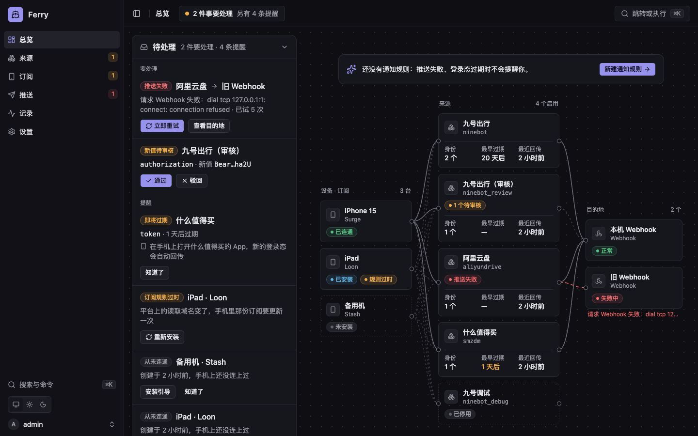
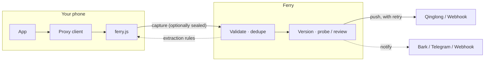

<p align="center">
  
</p>

<h1 align="center">Ferry</h1>

<p align="center">
  <strong>Your sessions, ferried home.</strong><br>
  Catch the login state your own apps emit on your own phone, verify and keep it, then deliver it to your own automation.
</p>

<p align="center">
  <a href="LICENSE"></a>
  <a href="https://github.com/lonelyman0108/ferry/actions/workflows/ci.yml"></a>
  
  
</p>

<p align="center">
  <a href="#quick-start">Quick start</a> ·
  <a href="docs/getting-started.md">Walkthrough</a> ·
  <a href="docs/architecture.md">How it works</a> ·
  <a href="docs/security.md">Security model</a> ·
  <a href="README.md">简体中文</a>
</p>

<p align="center">
  
</p>

> [!NOTE]
> The interface and the in-depth docs are in Chinese. This page is a translated overview.

## Why Ferry

Sign-in scripts on Qinglong live and die by login state, and login state always expires. The usual fixes — copying tokens out of packet captures by hand, or maintaining a bespoke plugin for every app — are tedious and brittle.

Ferry takes a different stance: **a session is only ever minted when you open the app yourself, so that is the moment to catch it.**

- **One script, five clients.** Surge, Loon, Quantumult X, Stash and Egern share a single `ferry.js`; subscriptions are generated per client. Extraction rules live on the server and are fetched on demand — only a change of hostnames calls for updating the subscription.
- **Verify before you trust.** Every value is validated, optionally probed against the real service or held for review. JWT expiry is read automatically, and you are warned before it lapses.
- **Nothing is lost.** Each capture is a version you can inspect, restore or re-push. Viewing a raw value leaves an audit entry.
- **Delivery you can see.** Output variables are written to Qinglong or a webhook, failures retry with backoff, and the result is drawn on a single flow graph.
- **One binary, one port.** Go with an embedded UI; SQLite out of the box, PostgreSQL or MySQL when you need them.

## What it works with

| | |
| :-- | :-- |
| **Proxy clients** |       |
| **Destinations** |   |
| **Notifications** |    |
| **Databases** |    |

## Scope

Ferry is built for exactly one situation: **your accounts, your devices, your automation.**

| Principle | Where it shows |
|---|---|
| Only your own accounts | Every source is configured by you; there is no shared rule library |
| Only your own devices | Subscriptions are installed by hand and trust a certificate you generate |
| Every capture is visible | The phone shows a notification by default; a full audit trail is kept |
| Nothing hidden, nothing spread | No silent mode, no bulk distribution, no bypasses |

## Quick start

> [!NOTE]
> Prebuilt images and binaries are on the way. For now, build from source (Go, see `go.mod`, plus Node).

```bash
git clone https://github.com/lonelyman0108/ferry.git && cd ferry
(cd web && npm ci && npm run build)
go build -tags embed_ui -o ferry ./cmd/ferry
./ferry serve
```

Then four steps to your first working chain:

1. **Initialise** — a one-time setup token is printed to the log; open `http://localhost:8080` and let the wizard pick a database, generate the master key and create the admin.
2. **Add a source** — import the built-in example or configure your own; paste a sample request and see matching and extraction results instantly.
3. **Install a subscription** — generate one for the proxy client on your phone and install it in one tap; from then on, simply opening the app sends the login state back.
4. **Set up delivery** — add a Qinglong or webhook destination and a push rule; new values arrive automatically once they take effect.

## How it works



The phone only picks out declared fields as requests pass by; validation, versioning and delivery all happen on the server. Components, the full journey of a capture and the core concepts are documented in [How it works](docs/architecture.md) (Chinese).

## License

[Apache-2.0](LICENSE)
