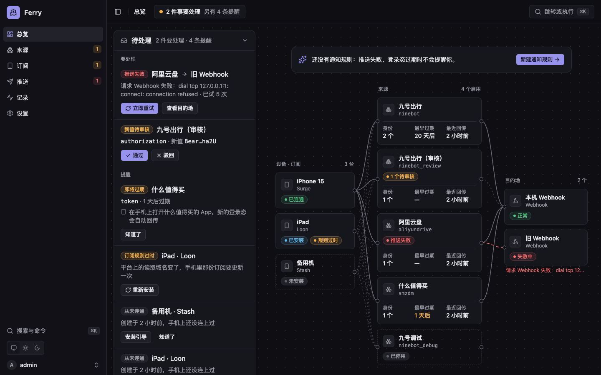
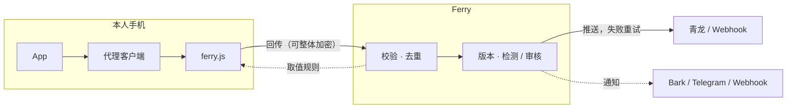
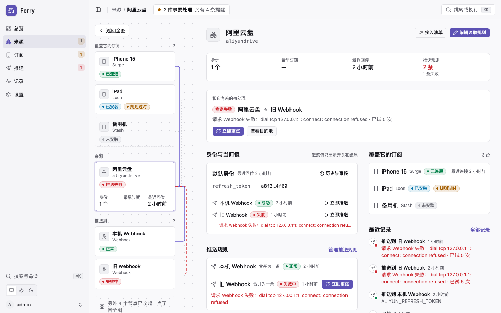

<p align="center">
  
</p>

<h1 align="center">Ferry</h1>

<p align="center">
  <strong>登录态的摆渡人。</strong><br>
  在你自己的手机上接住 App 的登录态，校验、留档，再稳稳送到你的自动化任务里。
</p>

<p align="center">
  <a href="LICENSE"></a>
  <a href="https://github.com/lonelyman0108/ferry/actions/workflows/ci.yml"></a>
  
  
</p>

<p align="center">
  <a href="#快速开始">快速开始</a> ·
  <a href="docs/getting-started.md">上手教程</a> ·
  <a href="docs/architecture.md">工作原理</a> ·
  <a href="docs/security.md">安全模型</a> ·
  <a href="README.en.md">English</a>
</p>

<p align="center">
  
</p>

## 为什么是 Ferry

青龙里的签到脚本离不开登录态，而登录态总会过期。过期之后，要么翻抓包记录手动复制，要么给每个 App 单写一个读取插件——两条路都不体面。

Ferry 换了一种做法：**登录态只在你本人打开 App 时产生，就在那一刻接住它。**

- **一份脚本，五种客户端。** Surge、Loon、Quantumult X、Stash、Egern 共用同一个 `ferry.js`，订阅按客户端各自生成；取值规则在后台改，手机下次自动拉取，只有域名变了才需要更新订阅。
- **先验，再信。** 每个新值都要过格式校验，可选主动检测或人工审核；JWT 的过期时间自动读出，快过期前提醒你。
- **留档可回溯。** 每一次取值都是一个版本，随时查看、恢复、重推；谁在何时看过原值，审计里都有记录。
- **推送有始有终。** 输出变量按规则写进青龙或 Webhook，失败指数退避重试，结果画在流向图上，一眼可见。
- **一个二进制，一个端口。** Go 编译，内嵌管理界面；SQLite 开箱即用，需要时换 PostgreSQL 或 MySQL。

## 支持什么

| | |
| :-- | :-- |
| **代理客户端** |       |
| **目的地** |   |
| **通知** |    |
| **数据库** |    |

各客户端在模块语法和脚本 API 上的差异，整理在 [客户端差异](docs/clients.md)。

## 边界

Ferry 只为一种场景而生：**本人账号、本人设备、本人的自动化任务。**

| 原则 | 落在哪里 |
|---|---|
| 只同步自己的账号 | 每个来源由使用者亲手配置，没有公共规则库 |
| 只在自己的设备上运行 | 订阅要本人手动安装，并信任自己生成的证书 |
| 每一次回传都看得见 | 手机端默认弹出通知，后台保留完整审计 |
| 不做隐藏，不做扩散 | 不提供静默模式、批量分发或绕过手段 |

## 快速开始

```bash
docker run -d --name ferry -p 8080:8080 -v ferry-data:/data ghcr.io/lonelyman0108/ferry:latest
docker logs ferry        # 记下 setup_token=… 这一行
```

镜像同时提供 amd64 与 arm64，Docker Hub 上是 `lonelyman0108/ferry`。想用 compose、PostgreSQL，或直接下载二进制，见 [部署与配置](docs/deployment.md)。

然后四步走完第一条链路：

1. **初始化** —— 打开 `http://localhost:8080`，填上日志里的初始化令牌，按向导选数据库、生成主密钥、创建管理员。
2. **建来源** —— 从内置示例导入，或在编辑器里自己配置；贴一段样例请求，匹配与取值结果当场可见。
3. **装订阅** —— 为手机上的代理客户端生成订阅，一键安装；之后正常打开 App，登录态就会回传。
4. **配推送** —— 新建青龙或 Webhook 目的地，再加一条推送规则；新值生效后自动送达。

每一步的细节与截图，见 [上手教程](docs/getting-started.md)。

## 它是怎么运转的



手机只负责在请求经过时取出声明过的字段；校验、留档、分发都在服务端完成。组件划分、一次回传的完整旅程与核心概念，见 [工作原理](docs/architecture.md)。

<p align="center">
  
  <br><sub>点任一节点，图收成窄栏，只留与它相关的链路。截图为本机测试实例的演示数据。</sub>
</p>

## 文档

| | |
|---|---|
| [上手教程](docs/getting-started.md) | 从第一个来源到推送进青龙的完整走查 |
| [工作原理](docs/architecture.md) | 组件、一次回传的完整旅程、核心概念与后端模块 |
| [安全模型](docs/security.md) | 主密钥、三种令牌、传输加密，能防与不能防的 |
| [部署与配置](docs/deployment.md) | 运行方式、配置项、访问地址与备份 |
| [客户端差异](docs/clients.md) | 五种客户端的模块语法与脚本 API |
| [参与开发](CONTRIBUTING.md) | 本地运行、测试、提交与 PR 规范 |
| [安全问题报告](SECURITY.md) | 发现漏洞时如何私下告知 |

## 许可证

[Apache-2.0](LICENSE)
