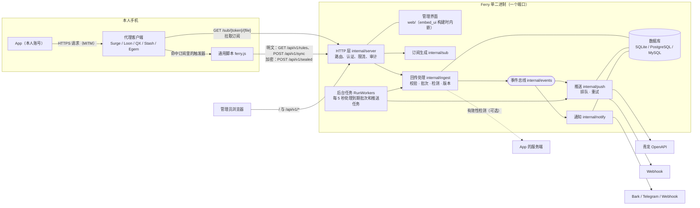
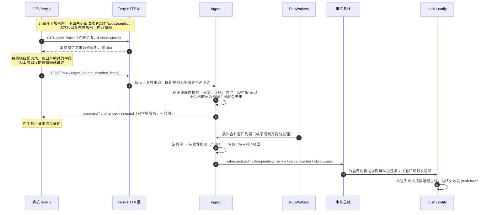

# Ferry

个人登录态同步工具：在自己的手机代理客户端（Surge / Loon / Quantumult X / Stash / Egern，Shadowrocket 复用 Surge 格式）里读取本人账号的登录态，Ferry 保存版本、做校验后，同步给自己的自动化任务（如青龙）。

Go 单二进制，内嵌 Vue 3 + shadcn-vue 管理界面；存储用 GORM，支持 SQLite / PostgreSQL / MySQL。

## 使用范围

Ferry 是**自用**的个人自动化工具：把**本人账号**在**本人设备**上的登录态（App 自己发出的 token、Cookie 等）同步给**本人**的自动化任务（如青龙里的签到脚本），省去每次登录态过期后手动复制。

- 只同步使用者自己的账号；来源由使用者本人在后台逐个配置。
- 只在使用者自己的设备上运行：订阅需要使用者在自己的代理客户端里手动安装，并信任自己生成的证书。
- 不做静默采集：每次回传都会在手机上弹出可见通知（默认开启），后台保留完整的审计记录。
- 不面向第三方设备或他人账号，也不提供任何隐藏、绕过或扩散的能力。

## 做什么

青龙里的签到脚本要用本人账号的登录态，登录态过期后，原来只能手动从手机里复制出来，而且每个 App 都要单独写一个读取插件。Ferry 把这件事变成一个独立的平台：

1. 在管理界面里为每个 App 配置一个**来源**：匹配哪些请求、从哪里取哪些字段、怎么拼成输出变量。
2. 为每台设备、每个代理客户端生成一份**订阅**，在手机上手动安装。
3. 本人正常打开 App 时，手机端的通用脚本取出登录态**回传**给 Ferry。
4. Ferry 校验、去重、按需做有效性检测，保存成**版本**；新值生效后**推送**到青龙等**目的地**，并按规则发**通知**。

## 界面

总览是一张流向图：左边是装了订阅的设备，中间是来源，右边是目的地，连线的样式表示通不通（实线正常、红虚线失败、灰点线没连通或没推过）。左上角的待处理里，新值审核、推送重试都能当场处理。支持深浅两色。


点任意一个节点，图收成左侧的窄栏，只留和它相关的链路，右边是详情：身份与当前值（敏感值打码）、推送规则与结果、覆盖它的订阅、最近记录。


截图里是本机测试实例的演示数据。

## 整体架构

### 组件



一个进程、一个端口同时提供：管理界面、管理 API（`/api/v1/*`）、订阅文件（`/sub/{token}/{file}`）、通用脚本（`/script/ferry.js`）和健康检查（`/healthz`）。模块之间不直接互调：回传处理只发事件，推送和通知各自订阅事件总线，所以加一种目的地或通知渠道不用动回传逻辑。

### 一次回传的完整过程



几个关键设计：

- **手机端取值，服务端复核**（[ADR 0002](docs/adr/0002-client-side-extraction.md)）：只有一份通用脚本，规则在运行时下发，只回传声明过的字段；服务端用同一套取值语义再复核一遍。JS 版（`script/ferry.js`）和 Go 版（`internal/rules`）共用 `internal/rules/testdata/extract_cases.json` 测试样例。
- **订阅只是触发器**：订阅文件里只声明哪些请求要调起脚本、要不要带正文，具体取什么由脚本拉到的规则决定。所以新增字段不用重装订阅，只有 MITM 域名变化才需要（[ADR 0003](docs/adr/0003-dynamic-mitm.md)，会发 `subscription.mitm_changed` 通知并附带一键更新链接）。
- **批次**：同一订阅、同一来源在合并窗口（默认 60 秒）内的回传合并为一批，因为一个 App 的不同字段常常出现在不同请求里。批次关闭时分三步：只读准备（定身份、合并取值）→ 事务外检测 → 事务内用带条件的 UPDATE 认领并写结果，避免后台任务和即时处理重复写入。
- **身份**：来源可以指定一个身份字段（如 JD 的 `pt_pin`），同一来源下的多个账号按它区分；缺身份字段的批次沿用同一订阅上一次的身份。
- **版本**：每次取值都是一个版本，状态有待处理、待审核、有效、驳回；可以人工审核，也可以恢复任意一个有效过的版本并重新推送。每个“身份 + 字段”至少保留最近 50 个版本，180 天内的全部保留，当前值永远保留。
- **推送**：推送规则把来源的输出变量推到目的地，有两种写法：每个身份一条（备注 `ferry:<来源>:<身份>`）和合并为一条（多个身份用 `&` 连接，备注 `ferry:<来源>`）。青龙里只管理备注以 `ferry:` 开头的变量。失败从 30 秒开始指数退避，最多试 5 次。
- **事件不带值**：事件、通知、审计记录、回传响应里只有来源、身份和字段名，从不包含登录态原文。

### 核心概念

| 术语 | 含义 | 例子 |
|---|---|---|
| 来源 Source | 一个需要同步登录态的 App 或站点（本人账号） | 九号出行 |
| 匹配规则 Matcher | 来源下的一条请求匹配：域名、路径正则、请求方法 | `cn-cbu-gateway.ninebot.com` + `^/portal/api/` |
| 字段 Field | 从请求里取的一个值：取值位置、类型、是否敏感、校验 | `authorization` ← 请求头 `Authorization`（JWT） |
| 输出变量 Output | 推给目的地的变量，由字段经模板拼成 | `NINEBOT_AUTHORIZATION = {{.authorization}}` |
| 有效性检测 Probe | 批次关闭时用新值请求一次目标服务，确认登录态有效（可选） | 查一次签到状态，判定 `json.code == 0` |
| 身份 Identity | 同一来源下的不同账号，由身份字段区分；界面上在“登录态”页 | — |
| 版本 Version | 某个身份某个字段的一次取值；界面上称“历史值” | — |
| 订阅 Subscription | 给某台设备、某个客户端生成的插件，带独立令牌 | iPhone · Surge |
| 访问地址 Endpoint | 手机访问 Ferry 用的地址，可以配多个，订阅可设主地址和备用地址 | 局域网 / 公网域名 |
| 目的地 Destination | 推送目标 | 青龙、Webhook |
| 推送规则 Binding | 把来源的输出变量推到目的地，可以改变量名 | 九号 → 青龙 |
| 通知渠道 / 通知规则 | 发到哪里 / 什么事件、哪些来源发 | Bark；“推送失败 → Bark” |

### 后端模块

| 包 | 职责 |
|---|---|
| `cmd/ferry` | 程序入口，子命令 `serve`、`version` |
| `internal/config` | 读 `ferry.yaml` 并叠加 `FERRY_*` 环境变量 |
| `internal/store` | GORM 模型、连接与迁移，三种数据库共用 |
| `internal/secret` | 主密钥：AES-256-GCM 加密（带 AAD，密文挪到别的行会解密失败）、HMAC 去重 |
| `internal/auth` | 密码哈希（bcrypt）、令牌生成与哈希 |
| `internal/source` | 来源文档：校验、存取、YAML 导入导出、内置示例（`examples/`）、给脚本的规则 |
| `internal/rules` | 请求匹配与取值引擎（Go 版，服务端复核用） |
| `internal/validate` | 字段静态校验：长度、正则、按类型检查，JWT 取过期时间 |
| `internal/probe` | 有效性检测：模板渲染请求，用 expr 表达式判定 |
| `internal/sub` | 各客户端订阅文件生成、订阅与脚本地址、一键安装链接 |
| `internal/ingest` | 回传、批次、身份、版本、审核与恢复、版本清理、即将过期检查 |
| `internal/events` | 进程内事件总线，事件只带 ID、key 和字段名 |
| `internal/dest` | 目的地适配器：青龙 OpenAPI、Webhook（可选 HMAC 签名） |
| `internal/push` | 推送任务：按推送规则渲染变量、排队、认领、重试 |
| `internal/notify` | 通知渠道（Bark、Telegram、Webhook）与按通知规则分发 |
| `internal/server` | 全部 HTTP 接口、初始化向导、认证、限流、审计、后台任务、管理界面路由回退 |
| `internal/buildinfo` | 版本号与构建信息 |
| `script/ferry.js` | 手机端通用脚本（只用 ES2015），适配各客户端的脚本 API |
| `web/` | 管理界面：Vue 3 + Vite + shadcn-vue，`embed_ui` 构建标签控制是否内嵌 |

### 安全设计

- **主密钥**：初始化时生成，用来加密敏感字段的值、订阅令牌原文、目的地和通知渠道的整份配置。丢失后这些数据无法解密，要和数据库一起备份。
- **令牌分三种**：
  - 管理员会话放在 Cookie 里，30 天有效；用 Cookie 的写请求必须是 JSON，跨站页面发不出这种请求。
  - API 令牌 `fy_` 只读，不返回敏感原值。
  - 订阅令牌 `fs_` 只能拉订阅文件、规则和回传（加密订阅只用它下载订阅文件），数据库里存哈希和一份加密原文，可以随时更换。
- **初始化向导**：未初始化时，每次启动在日志里打印一次性令牌，向导必须凭它访问；初始化完成后向导接口不再可用。
- **只写不读**：目的地和通知渠道的密钥保存后不回显，编辑时留空表示不改。
- **查看原值要留痕**：界面上默认只显示敏感值的掩码，点“显示”才向后端要原文，并写一条审计记录。
- **传输加密**（[ADR 0004](docs/adr/0004-transport-encryption.md)）：订阅可以开启加密传输。开启后，手机和平台之间的整个报文用每个订阅一把的传输密钥加密（NaCl secretbox），访问地址是 http 时也读不到、改不了；带时间窗和 nonce 去重，不能重放；回复绑定请求，不能冒充平台。
  - 密钥由平台生成，用户从订阅详情里复制，填进客户端的模块参数；订阅文件里只有密钥编号，没有密钥，也没有令牌。
  - 开了加密的订阅不再接受明文接口；手机走过加密后也不会退回明文。
  - 防不住的：订阅文件和脚本本身走 http 下载时可能被替换，请在可信网络（家里局域网或 https）下安装和更新模块；管理界面也应在可信网络里打开。Quantumult X 没有模块参数，只能明文，建议给它用 https 访问地址。
- **限流**：登录失败 15 分钟内超过 5 次即锁定；手机端接口按 IP 限流，每分钟 120 次。不信任 `X-Forwarded-For`，避免伪造转发头绕过限流。

## 本地运行

需要 Go（版本见 `go.mod`）和 Node（前端，用 `web/package-lock.json` 锁定依赖）。

```bash
scripts/bootstrap.sh      # 克隆后执行一次：启用提交钩子、检查工具
scripts/check.sh          # 门禁：与 CI 完全一致（纯文档改动可用 --quick）
```

开发时前后端分开跑：

```bash
go run ./cmd/ferry serve                              # 后端，默认 :8080
cd web && npm install && npm run dev                  # 前端，Vite 把 /api、/sub/、/script/ 转发给后端
FERRY_API=http://127.0.0.1:8098 npm run dev           # 后端不在 8080 时指定地址
```

第一次启动没有配置，日志会打印初始化令牌；打开管理界面，按向导选数据库、生成主密钥、创建管理员。

带界面的完整构建：

```bash
(cd web && npm ci && npm run build)
go build -tags embed_ui -o ferry ./cmd/ferry
./ferry serve -config ferry.yaml
./ferry version
```

不带 `embed_ui` 编译出的二进制没有管理界面，打开首页只显示提示页；`go vet`、`go test` 时 `web/dist` 可能还没构建，所以默认不内嵌。

测试：

- `go test ./...`：后端单测，CI 只跑 SQLite。
- `node --test script/ferry.test.js`：手机端脚本。
- 改了 `internal/store` 时，用专用的空 PostgreSQL、MySQL 库设好 `FERRY_TEST_POSTGRES_DSN`、`FERRY_TEST_MYSQL_DSN`，再跑 `go test ./internal/store/`。测试会删光库里的表，不要指向共享库。

## 部署或安装

打包与部署（Dockerfile、macOS 二进制与 launchd 示例、可信代理配置、发版流程）还在进行中，见[开发计划](docs/plans/开发计划.md)的阶段 9。在那之前，用上面的完整构建得到二进制，直接运行 `ferry serve`。

部署时要注意：

- 手机要能访问 Ferry：在“系统设置 → 访问地址”里填手机可达的地址（可以配多个，比如局域网和公网）。订阅和回传都用这些地址。
- 备份数据库时连同主密钥一起备份（配置文件里的 `master_key`，或环境变量 `FERRY_MASTER_KEY`）。

## 配置项

配置来自 `ferry.yaml`，环境变量会覆盖文件里的同名项；Docker 部署时可以只用环境变量、不写配置文件。文件和环境变量都没给出数据库和主密钥时，进入初始化向导。

| 配置文件 | 环境变量 | 默认值 | 说明 |
|---|---|---|---|
| — | `FERRY_CONFIG` | `ferry.yaml` | 配置文件路径，也可以用 `serve -config` 指定 |
| `listen` | `FERRY_LISTEN` | `:8080` | 监听地址，可被 `serve -addr` 覆盖 |
| `database.driver` | `FERRY_DATABASE_DRIVER` | — | `sqlite`、`postgres` 或 `mysql` |
| `database.dsn` | `FERRY_DATABASE_DSN` | — | 连接串；SQLite 是文件路径 |
| `master_key` | `FERRY_MASTER_KEY` | — | base64 编码的 32 字节主密钥，向导会自动生成 |

## 文档

- 开发计划与进度：[docs/plans/开发计划.md](docs/plans/开发计划.md)
- 设计决策：[docs/adr/](docs/adr/)
- 各客户端的订阅语法与脚本 API 差异：[docs/clients.md](docs/clients.md)
- 平台与仓库设置：[docs/SETUP.md](docs/SETUP.md)
- 贡献规范：[CONTRIBUTING.md](CONTRIBUTING.md)
- agent 工作约定：[AGENTS.md](AGENTS.md)
- 文档索引：[docs/README.md](docs/README.md)
- 更新日志：[CHANGELOG.md](CHANGELOG.md)
