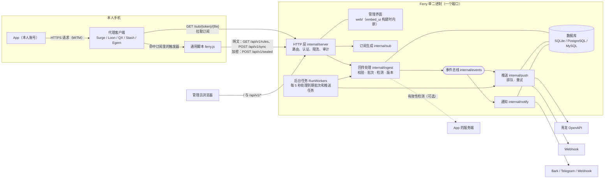
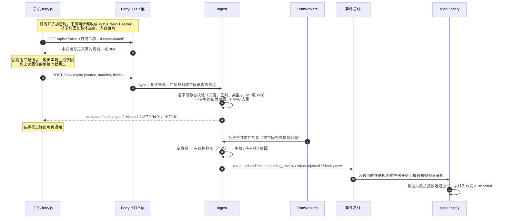

# 工作原理

> 一句话：**手机只在请求经过时取出声明过的字段，其余一切——校验、留档、分发——都在服务端完成。**

这份文档从组件讲到一次回传的完整旅程，再落到每个核心概念与后端模块。只想跑起来，先看 [上手教程](getting-started.md)；关心数据怎么被保护，看 [安全模型](security.md)。

## 组件

一个进程、一个端口，同时承载：管理界面、管理 API（`/api/v1/*`）、订阅文件（`/sub/{token}/{file}`）、通用脚本（`/script/ferry.js`）和健康检查（`/healthz`）。

模块之间不直接互调：回传处理只发事件，推送和通知各自订阅事件总线，所以加一种目的地或通知渠道不用动回传逻辑。

## 一次回传的旅程

几处值得多看一眼的设计：

- **手机端取值，服务端复核**（[ADR 0002](adr/0002-client-side-extraction.md)）：只有一份通用脚本，规则在运行时下发，只回传声明过的字段；服务端用同一套取值语义再复核一遍。JS 版（`script/ferry.js`）和 Go 版（`internal/rules`）共用 `internal/rules/testdata/extract_cases.json` 测试样例。
- **订阅只是触发器**：订阅文件里只声明哪些请求要调起脚本、要不要带正文，具体取什么由脚本拉到的规则决定。所以新增字段不用重装订阅，只有 MITM 域名变化才需要（[ADR 0003](adr/0003-dynamic-mitm.md)，会发 `subscription.mitm_changed` 通知并附带一键更新链接）。
- **批次**：同一订阅、同一来源在合并窗口（默认 60 秒）内的回传合并为一批，因为一个 App 的不同字段常常出现在不同请求里。批次关闭时分三步：只读准备（定身份、合并取值）→ 事务外检测 → 事务内用带条件的 UPDATE 认领并写结果，避免后台任务和即时处理重复写入。
- **身份**：来源可以指定一个身份字段（如 JD 的 `pt_pin`），同一来源下的多个账号按它区分；缺身份字段的批次沿用同一订阅上一次的身份。
- **版本**：每次取值都是一个版本，状态有待处理、待审核、有效、驳回；可以人工审核，也可以恢复任意一个有效过的版本并重新推送。每个“身份 + 字段”至少保留最近 50 个版本，180 天内的全部保留，当前值永远保留。
- **推送**：推送规则把来源的输出变量推到目的地，有两种写法：每个身份一条（备注 `ferry:<来源>:<身份>`）和合并为一条（多个身份用 `&` 连接，备注 `ferry:<来源>`）。青龙里只管理备注以 `ferry:` 开头的变量。失败从 30 秒开始指数退避，最多试 5 次。
- **事件不带值**：事件、通知、审计记录、回传响应里只有来源、身份和字段名，从不包含登录态原文。

## 核心概念

| 术语 | 含义 | 例子 |
|---|---|---|
| 来源 Source | 一个需要同步登录态的 App 或站点（本人账号） | 九号出行 |
| 匹配规则 Matcher | 来源下的一条请求匹配：域名、路径正则、请求方法 | `cn-cbu-gateway.ninebot.com` + `^/portal/api/` |
| 字段 Field | 从请求里取的一个值：取值位置、类型、是否敏感、校验 | `authorization` ← 请求头 `Authorization`（JWT） |
| 输出变量 Output | 推给目的地的变量，由字段经模板拼成 | `NINEBOT_AUTHORIZATION = {{.authorization}}` |
| 有效性检测 Probe | 批次关闭时用新值请求一次目标服务，确认登录态有效（可选） | 查一次签到状态，判定 `json.code == 0` |
| 身份 Identity | 同一来源下的不同账号，由身份字段区分；界面上在来源详情里 | — |
| 版本 Version | 某个身份某个字段的一次取值；界面上称“历史值” | — |
| 订阅 Subscription | 给某台设备、某个客户端生成的插件，带独立令牌 | iPhone · Surge |
| 访问地址 Endpoint | 手机访问 Ferry 用的地址，可以配多个，订阅可设主地址和备用地址 | 局域网 / 公网域名 |
| 目的地 Destination | 推送目标 | 青龙、Webhook |
| 推送规则 Binding | 把来源的输出变量推到目的地，可以改变量名 | 九号 → 青龙 |
| 通知渠道 / 通知规则 | 发到哪里 / 什么事件、哪些来源发 | Bark；“推送失败 → Bark” |

## 后端模块

| 包 | 职责 |
|---|---|
| `cmd/ferry` | 程序入口，子命令 `serve`、`version` |
| `internal/config` | 读 `ferry.yaml` 并叠加 `FERRY_*` 环境变量 |
| `internal/store` | GORM 模型、连接与迁移，三种数据库共用 |
| `internal/secret` | 主密钥：AES-256-GCM 加密（带 AAD，密文挪到别的行会解密失败）、HMAC 去重 |
| `internal/auth` | 密码哈希（bcrypt）、令牌生成与哈希 |
| `internal/source` | 来源文档：校验、存取、YAML 导入导出、内置示例（`examples/`）、给脚本的规则 |
| `internal/rules` | 请求匹配与取值引擎（Go 版，服务端复核用） |
| `internal/validate` | 字段静态校验：长度、正则、按类型检查，JWT 取过期时间 |
| `internal/probe` | 有效性检测：模板渲染请求，用 expr 表达式判定 |
| `internal/sub` | 各客户端订阅文件生成、订阅与脚本地址、一键安装链接 |
| `internal/ingest` | 回传、批次、身份、版本、审核与恢复、版本清理、即将过期检查 |
| `internal/events` | 进程内事件总线，事件只带 ID、key 和字段名 |
| `internal/dest` | 目的地适配器：青龙 OpenAPI、Webhook（可选 HMAC 签名） |
| `internal/push` | 推送任务：按推送规则渲染变量、排队、认领、重试 |
| `internal/notify` | 通知渠道（Bark、Telegram、Webhook）与按通知规则分发 |
| `internal/server` | 全部 HTTP 接口、初始化向导、认证、限流、审计、后台任务、管理界面路由回退 |
| `internal/buildinfo` | 版本号与构建信息 |
| `script/ferry.js` | 手机端通用脚本（只用 ES2015），适配各客户端的脚本 API |
| `web/` | 管理界面：Vue 3 + Vite + shadcn-vue，`embed_ui` 构建标签控制是否内嵌 |

## 管理界面

管理界面是 Vue 3 + shadcn-vue 写的单页应用，构建产物在 `embed_ui` 构建标签下内嵌进二进制。

- **总览即流向图**：三列节点（设备 → 来源 → 目的地），连线的位置按节点实际渲染的位置量出来，线型表示通断；数据来自 `GET /api/v1/flow`。左上角的待处理取自 `GET /api/v1/overview` 的 `items`，每条都带着就地处理所需的 ID。
- **聚焦**：`/sources/:id`、`/subscriptions/:id`、`/destinations/:id` 与总览是同一个页面组件。切换时记下各节点卡的位置，再让同一节点从旧位置滑到窄栏；来源详情一次取自 `GET /api/v1/sources/{id}/lane`。
- **记录**：`GET /api/v1/activity` 把批次、审核、推送与通知按时间合成一条时间线。
- **深浅两色**：颜色全部来自 CSS 变量，跟随系统或手动切换，选择存在浏览器里。
